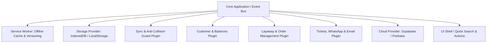

# 📦 Sistema de Encargos, Envíos y Sistema por Apartado (Layaway)
## Documento Maestro del Proyecto (`proyecto.md`)
*Encarrilado bajo la metodología modular de DeepSeek Harness (Cordis Architecture)*

---

## 1. 🎯 Visión y Objetivos del Proyecto

El sistema está concebido para emprendedores y comisionistas que realizan compras y traslados de productos por encargo hacia otras ciudades o localidades, operando también como un **Sistema por Apartado (Layaway)** flexible.

### Principales Necesidades del Negocio:
1. **Control de Anticipos:** Exigir y registrar un abono previo (por defecto 50% o porcentaje/monto personalizado por cliente/pedido) antes de realizar la compra del producto.
2. **Sistema por Apartado y Abonos Progresivos:** Permitir que los clientes vayan pagando sus encargos en cuotas/abonos a su ritmo, visualizando en todo momento el avance de pago (ej. 75% completado).
3. **Búsqueda Instantánea & Liquidación Rápida:**
   * Al buscar por **Cliente** o por **Producto encargado**, mostrar inmediatamente su saldo pendiente.
   * Acciones rápidas en un clic: **`+ Agregar Abono`** (abono parcial) y **`⚡ Cancelación Total`** (liquidar el 100% de la deuda al instante con confirmación y comprobante).
4. **Control Financiero por Cliente:** Seguimiento de saldo deudor acumulado (cuánto resta por pagar para saldar sus encargos) y saldo a favor.
5. **Logística y Trazabilidad:** Registro claro del lugar de entrega (ciudad/dirección) y fecha prevista de entrega o arribo.
6. **Comprobantes Omnicanal:** Envío automático de resumen por **WhatsApp**, **Email** e **Impresión de Tickets Térmicos** (58mm/80mm o PDF/recibo).
7. **PWA & Funcionamiento Offline-First con Service Worker:** Operación 100% autónoma en el navegador (móvil o PC) mediante **IndexedDB** y **Service Worker (`sw.js`)**.
8. **Control de Versiones y Notificación de Actualizaciones:** Mecanismo donde el Service Worker detecta nuevas versiones en el servidor y muestra un banner al usuario para actualizar con 1 clic (`SKIP_WAITING`) sin perder su sesión ni datos.
9. **Sincronización Nube Híbrida y Guardián Anti-Pisado:**
   * Al contar con conexión a internet y credenciales de Supabase, descarga y sincroniza la última base de datos.
   * Si no hay internet, continúa trabajando fluidamente sin interrupciones con la última versión cargada.
   * **Guardián Anti-Colisión:** Algoritmo de comparación registro por registro basado en fechas de modificación (`updatedAt`). Impide terminantemente que una base antigua (de la nube o de un respaldo JSON viejo) sobrescriba modificaciones o abonos recientes hechos localmente.
10. **Georreferenciación y Rutas Directas en Google Maps:**
   * Destinos en el Dashboard y píldoras en las tarjetas de pedido 100% clicables para abrir la ruta en Google Maps (`google.com/maps/dir/...`).
   * Al registrar nuevos encargos, permite agregar el destino por ciudad, dirección/punto, pegar un enlace de Google Maps (de WhatsApp) o capturar las coordenadas exactas con el botón **`📍 Capturar mi GPS Actual`**.

---

## 2. 🧬 Estructura y Metodología DeepSeek Harness (Cordis)

El proyecto adopta los principios de diseño de **DeepSeek Harness / Cordis**:

* **Todo es un Plugin / Módulo Autónomo:** Cada dominio funcional está desacoplado con interfaces estrictas.
* **Separación Clara de Roles:**
  * **Service Definition:** Interfaces y tipos que definen qué hace el servicio.
  * **Provider:** Implementación concreta (ej. `IndexedDBStorageProvider`, `SupabaseCloudProvider`, `ServiceWorkerPWAProvider`).
  * **Consumer:** Vistas o controladores que consumen la capability mediante inyección de dependencias.
* **ESM Estricto:** Módulos nativos JavaScript (ES Modules), sin dependencias obsoletas ni CommonJS.
* **Declarativo y Configurable:** Todo parámetro (porcentajes de anticipo, monedas, datos de empresa, credenciales) se declara en configuración centralizada.
* **Harness Local Activo:** Servidor de metodología y orquestación operando en `http://127.0.0.1:3080`.

### Mapa de Plugins del Sistema


---

## 3. 👥 Modelo de Datos e Información

### 3.1. Entidad: Cliente (`Customer`)
```json
{
  "id": "uuid-v4",
  "nombre": "Juan Pérez",
  "telefono": "+59170012345",
  "email": "juan@example.com",
  "documentoIdentidad": "12345678",
  "ciudadDefault": "Cochabamba",
  "direccionDefault": "Av. Heroínas #456",
  "totalEncargos": 5,
  "saldoDeudorTotal": 140.00,
  "saldoFavorTotal": 0.00,
  "notas": "Cliente habitual, retira en terminal",
  "createdAt": "2026-10-20T10:00:00.000Z",
  "updatedAt": "2026-10-20T13:15:00.000Z"
}
```

### 3.2. Entidad: Encargo / Apartado (`LayawayOrder`)
```json
{
  "id": "ENC-20261020-0001",
  "clienteId": "uuid-v4",
  "clienteNombre": "Juan Pérez",
  "clienteTelefono": "+59170012345",
  "modalidad": "encargo_apartado",
  "fechaCreacion": "2026-10-20T10:30:00.000Z",
  "fechaEntregaEstimada": "2026-10-25",
  "lugarDestino": {
    "ciudad": "Cochabamba",
    "puntoEntrega": "Terminal de Buses / Domicilio",
    "direccion": "Av. Heroínas #456"
  },
  "items": [
    {
      "id": "item-1",
      "descripcion": "Zapatillas Nike Air Max Talla 42",
      "cantidad": 1,
      "precioUnitario": 120.00,
      "notas": "Color negro con blanco",
      "enlaceReferencia": ""
    }
  ],
  "costoItems": 120.00,
  "costoEnvioComision": 15.00,
  "costoTotal": 135.00,
  "anticipoExigidoTipo": "porcentaje",
  "anticipoExigidoValor": 50,
  "montoAnticipoCalculado": 67.50,
  "historialAbonos": [
    {
      "id": "abn-1",
      "fecha": "2026-10-20T10:35:00.000Z",
      "monto": 70.00,
      "metodo": "Transferencia QR",
      "comprobanteRef": "TR-9821",
      "concepto": "Anticipo inicial"
    }
  ],
  "totalAbonado": 70.00,
  "saldoPendiente": 65.00,
  "porcentajePagado": 51.85,
  "estado": "en_camino",
  "fechaLiquidacion": null,
  "notasInternas": "Comprar en tienda oficial",
  "updatedAt": "2026-10-20T13:20:00.000Z"
}
```

---

## 4. 📱 Módulos y Arquitectura de Sincronización

### 4.1. Service Worker & PWA (`sw.js`)
* **Nombre de versión:** `v1.1.0`.
* **Caché Offline:** Almacenamiento seguro del App Shell (`index.html`, `index.css`, `src/**/*.js`, manifiesto y fuentes).
* **Actualización en Caliente:** Al desplegar una nueva versión, el Service Worker descarga los nuevos archivos en segundo plano y despliega el banner: *"¡Nueva versión disponible! [Actualizar Ahora]"*. Al presionar el botón, se activa `SKIP_WAITING` y la app recarga suavemente conservando todos los datos intactos.

### 4.2. Guardián Anti-Colisión (Protección contra Pérdida de Datos)
* Todo registro posee un sello de tiempo ISO exacto con milisegundos (`updatedAt`).
* Algoritmo de Fusión Segura (`syncService.mergeRecords`):
  * **Caso 1:** El registro remoto es más nuevo que el local -> Se actualiza el local.
  * **Caso 2:** El registro local es más nuevo que el remoto (ej. abonos tomados en viaje sin internet) -> **Se respeta el dato local**, previniendo que la nube o una base vieja lo pise.
  * **Caso 3:** Restauración de respaldos JSON antiguos -> Se valida y alerta cuántos registros locales más nuevos fueron protegidos contra sobrescritura accidental.

### 4.3. Búsqueda Rápida & Sistema por Apartado
* Barra Omnibox en tiempo real.
* Botón **`+ Agregar Abono`** para cuotas parciales sucesivas.
* Botón **`⚡ Cancelación Total`** para liquidar en 1 clic dejando el saldo en cero.

### 4.4. Comprobantes Omnicanal
* **Ticket Térmico:** Formateado para impresoras de 58mm y 80mm con CSS `@media print`.
* **WhatsApp:** Mensaje dinámico con emojis y desglose financiero directo a `wa.me`.
* **Email:** Enlace `mailto:` prellenado.

---

## 5. 🛠️ Arquitectura de Carpetas del Proyecto

```text
SistemaEncargoProductos/
├── index.html                   # Shell principal de la SPA con PWA y banners
├── index.css                    # Design System, modo oscuro, print media y sync badges
├── sw.js                        # Service Worker PWA, Cache Offline y Versionado
├── manifest.json                # Web App Manifest instalable
├── src/
│   ├── app.js                   # Orquestador principal, eventos y control de ciclo de vida
│   └── services/                # Proveedores y servicios desacoplados
│       ├── storage.service.js   # Wrapper IndexedDB nativo (Offline-First)
│       ├── sync.service.js      # Guardián Anti-Pisado y Sincronización Nube
│       ├── customer.service.js  # Lógica de clientes y saldos acumulados
│       ├── order.service.js     # Motor de encargos, apartados, abonos y liquidación
│       ├── destination.service.js # Catálogo de ubicaciones, parser WhatsApp/Maps y rutas
│       ├── auth.service.js      # Gestión de roles (Admin/Despachador) y jerarquías
│       ├── notification.service.js # Generador de mensajes WhatsApp y Email
│       ├── print.service.js     # Formateador e impresor de tickets térmicos
│       └── cloud.service.js     # Conector Supabase y respaldo JSON seguro
└── proyecto.md                  # Este documento maestro
```

---

## 6. 📅 Estado de Fases de Desarrollo

| Fase | Título | Estado |
|---|---|---|
| **Fase 1** | **Estructura Base & Storage Local (IndexedDB)** | ✅ **Completada** |
| **Fase 2** | **Diseño del Sistema & Layout Moderno (Dark/Light)** | ✅ **Completada** |
| **Fase 3** | **Buscador Omnibox & Motor de Apartados (Abono + Liquidar)** | ✅ **Completada** |
| **Fase 4** | **Gestión de Encargos & Clientes con Perfil** | ✅ **Completada** |
| **Fase 5** | **Comprobantes: WhatsApp, Email & Ticket Térmico** | ✅ **Completada** |
| **Fase 6** | **Configuración & Integración Nube con Supabase** | ✅ **Completada** |
| **Fase 7** | **PWA, Service Worker, Offline & Guardián Anti-Pisado** | ✅ **Completada** |
| **Fase 8** | **Catálogo de Destinos, Rutas Google Maps & Ubicaciones WhatsApp** | ✅ **Completada** |
| **Fase 9** | **Usuarios por Cargo (Admin vs Despachador) & Jerarquía Operativa** | ✅ **Completada** |
| **Fase 10** | **Prefijo Telefónico Internacional (+58 Venezuela) & Validador WhatsApp** | ✅ **Completada** |
| **Fase 11** | **Servicio de Sincronización Realtime con Supabase & Guardián Anti-Colisión Multitabla** | ✅ **Completada** |

---

## 7. 📍 Fase 8: Catálogo de Destinos y Rutas Google Maps
- **Almacenamiento en IndexedDB:** Nueva tienda de objetos `destinations` con soporte de categorización (Terminal, Punto de Encuentro, Almacén, Domicilio).
- **Integración con Google Maps & WhatsApp:**
  - Parser inteligente capaz de procesar enlaces cortos de WhatsApp (`maps.app.goo.gl`), URLs directas de Google Maps y coordenadas GPS (`lat,lng`).
  - Generación de rutas directas `google.com/maps/dir/?api=1&destination=...` con 1 clic en tarjetas de encargo y catálogo de destinos.
  - Captura GPS nativa del navegador para fijar la ubicación exacta del usuario en el punto de entrega.
  - Auto-guardado opcional al crear un encargo mediante casilla *"Guardar como destino / ubicación frecuente para futuros usos"*.

## 8. 👥 Fase 9: Jerarquía de Usuarios por Cargo
- **Roles Implementados:**
  - 👑 **Administrador:** Acceso completo e irrestricto a configuración de empresa, credenciales Supabase, respaldo/restauración de base de datos, gestión y eliminación de usuarios, y finanzas.
  - 🚚 **Despachador:** Modo operativo enfocado en ruta. Puede consultar encargos, filtrar por ciudad, abrir ubicaciones en Google Maps, registrar abonos y gestionar destinos; las secciones críticas de configuración de empresa y backups quedan bloqueadas con aviso de seguridad.
- **Selector de Perfil Rápido:** Selector dinámico en barra superior para alternar instantáneamente la sesión y verificar la interfaz según el cargo.
- **Persistencia y Respaldo:** Los usuarios se almacenan en IndexedDB y se incluyen en las copias de seguridad JSON y sincronización cloud.

## 9. 📞 Fase 10: Prefijo Telefónico Configurable & Normalizador de WhatsApp
- **Campo en Configuración:** Permite establecer el prefijo de país (`+58` para Venezuela por defecto, o cualquier código internacional como `+57`, `+591`, `+1`).
- **Normalización Inteligente:**
  - Limpia formatos locales (ej. `0414-1234567` o `0424 555 1234` eliminan el `0` inicial de discado nacional y anteponen el `58` -> `584141234567`).
  - Acepta números con o sin código de país, evitando el error *"El número de teléfono compartido a través de la URL no es válido"* en WhatsApp.
  - Flujo inmediato: Tras registrar un abono o liquidar una deuda, el sistema ofrece enviar el comprobante actualizado por WhatsApp al cliente en 1 clic.

## 10. ⚡ Fase 11: Servicio de Sincronización Realtime con Supabase Multitabla
- **Módulo Dedicado (`src/services/supabase.service.js`):**
  - Inicialización dinámica con URL y clave pública anónima (anon key).
  - Carga universal del cliente `@supabase/supabase-js` v2 mediante CDN ESM con fallback a `window.supabase`.
- **Escucha en Tiempo Real (WebSockets & PostgreSQL Replication):**
  - Suscripción en vivo al canal para todas las tablas (`customers`, `orders`, `destinations`, `users`, `settings`).
  - Recepción y procesamiento instantáneo de eventos `INSERT`, `UPDATE` y `DELETE`.
- **Guardián Anti-Pisado / Anti-Colisión:**
  - Resolución inteligente basada en sellos de tiempo (`updatedAt`): si un dispositivo en ruta registra un abono u orden offline y luego se conecta, los datos locales más recientes nunca son pisados por datos remotos antiguos.
- **Cola Offline (Offline Queue) & Auto-Reconexión:**
  - Mutaciones locales sin conexión se encolan automáticamente y se envían a Supabase en cuanto se restablece la red.
- **Generador de Esquema SQL y Políticas RLS:**
  - Botón integrado en la vista de configuración: **`📋 Ver Script SQL para Supabase`** con copia en 1 clic, que incluye creación de tablas, políticas RLS para la Anon Key y configuración de `REPLICA IDENTITY FULL` en la publicación `supabase_realtime`.

## 11. 🔐 Fase 12: Autenticación por Credenciales, Primer Inicio y Aislamiento del Modo Despachador
- **Flujo de Primer Inicio en Dispositivo Limpio:**
  - En un dispositivo nuevo o limpio, la aplicación inicia con la pantalla de acceso.
  - El botón o tarjeta desplegable `⚙️ ¿Primera vez en este dispositivo? Configurar Supabase` permite al Administrador ingresar la URL y Anon Key del proyecto Supabase.
  - Al pulsar `📥 Guardar y Descargar Base`, se inicializa la conexión con Supabase, se descargan todas las tablas (`users`, `orders`, `customers`, `destinations`, `settings`) a IndexedDB local y la aplicación se reinicia automáticamente.
- **Acceso Estricto con Usuario y Contraseña:**
  - Pantalla de inicio de sesión persistente (`#appLoginOverlay`).
  - Validación local contra la tabla de usuarios descargada de Supabase o localmente almacenada.
  - Credenciales predeterminadas para pruebas:
    - 👑 **Admin:** Usuario: `admin` | Contraseña: `admin123`
    - 🚚 **Despachador:** Usuario: `carlos` | Contraseña: `1234`
- **Aislamiento Total del Modo Despachador:**
  - Al iniciar sesión como Despachador, la pestaña `⚙️ Configuración`, el `📊 Panel General` (con métricas financieras de la empresa) y la gestión de clientes `👥 Clientes` quedan **totalmente ocultos** del menú y protegidos en el enrutador (`switchView`).
  - Solo tiene acceso a lo que le atañe operativamente en la calle: `📦 Todos los Encargos`, `🔍 Búsqueda & Apartados` y `📍 Destinos & Rutas`.
- **Alternancia de Modo Ruta para el Administrador:**
  - El Administrador cuenta con un botón en la barra superior: `🚚 Modo Ruta`.
  - Permite al Administrador salir a entregar pedidos con la interfaz limpia y operativa de un despachador (sin pantallas de configuración ni distracciones).
  - Un botón `👑 Volver a Admin` en la cabecera permite regresar instantáneamente al modo de control total.
- **Gestión de Credenciales de Usuarios:**
  - En Configuración -> Usuarios del Sistema, el modal de creación y edición permite asignar el Nombre, Cargo (Admin o Despachador), **Usuario de Acceso** y **Contraseña / PIN**, los cuales se sincronizan automáticamente con Supabase.
